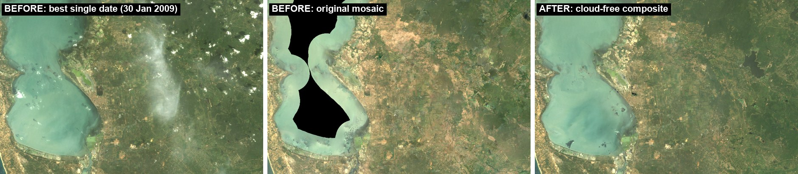
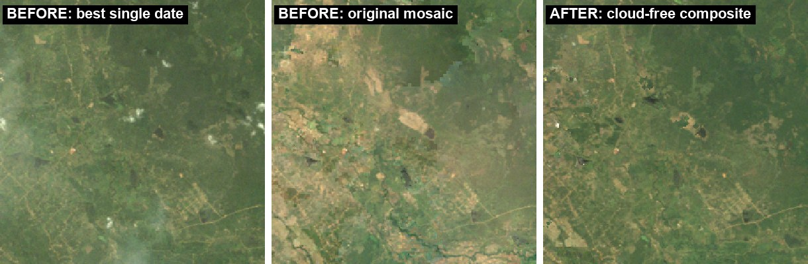

# cloud-free-landsat

This repo builds a cloud-, shadow- and haze-free Landsat image of an area from many dates. **Every pixel is one real observation of one date.** Nothing is averaged. A colour-matched copy is also written, for classification.

It is packaged as a [Claude Code](https://claude.com/claude-code) **skill** plus an **agent**. The script also runs on its own.

It works with Landsat 4/5/7 (TM/ETM+) and 8/9 (OLI) USGS Collection-2 Level-2 products, as `.tar` bundles or as extracted folders.

## Before / after

Puttalam lagoon, Sri Lanka, Landsat 5, 2009. The test box is 30 × 20 km (UTM 44N, E 360–390 km, N 880–900 km). All panels use the same colour stretch.



- **Best single date** (30 Jan 2009, 84 % USGS-clear over the box): cumulus, cloud shadows and a haze plume.
- **Original mosaic** (per-scene USGS mosaic before this method): date seams and hazy patches. The black area over the lagoon is no data in that mosaic.
- **Cloud-free composite**: this method, 25 dates from Jan–Sep with Jan–Apr preferred. Every pixel is one real date, and none are empty.

The zoomed panel is a 7.5 × 7.5 km window, picked as the land area where the original mosaic differs most from the result:



## What it does

1. **Per-date masks:**
   - USGS QA_PIXEL cloud, shadow and dilated-cloud bits (plus cirrus on OLI).
   - The cloud and shadow confidence ≥ medium bits.
   - A thermal cold-cloud test that only counts pixels that also look like cloud, so cool water and mangrove are not flagged.
   - A geometric shadow search near the detected clouds.
2. **Temporal outlier test** against the per-pixel median of the clear dates, to catch missed shadows and clouds.
3. **Dark-object haze test** per 1.5 km tile, relative to the clearest date at that tile.
4. **Speck test** for small cumulus and shadow blobs.
5. **Patch selection** per tile: the cleanest and least hazy date, with an optional preferred-season bonus. Edges are feathered. The real value is taken from the date with the most weight.
6. **Harmonised copy:**
   - A local Wallis match of each date to the clean median, with land and water matched separately.
   - For water, one smooth sea-colour field across all dates plus each date's own fine detail.
7. **Gaps** are filled with the least-hazy clear observation, else the observation closest to the reference.
8. **Optional `--keep-whole` polygons:** each plot is taken from one clean date.

## Install (Claude Code)

```bash
cp -r skills/landsat-cloudfree-composite ~/.claude/skills/
cp agents/cloudfree-composite.md ~/.claude/agents/
```

After that, ask Claude for "a cloud-free Landsat image of <area>". It uses the skill, or you can hand the job to the `cloudfree-composite` agent.

## Run the script directly

It needs Python with GDAL, numpy and scipy. The QGIS Python works, for example `python-qgis-ltr.bat` on Windows.

```bash
python skills/landsat-cloudfree-composite/scripts/cloudfree_composite.py \
  --bundles /data/landsat_bundles --aoi aoi.shp --crs EPSG:32644 \
  --years 2009 --season 0101-0930 --prefer 0101-0430 \
  --out out_dir --prefix myarea
```

- Run `--screen-only` first. It writes the per-date clear-share table in seconds.
- The AOI can be a vector file, a raster mask, or `--bounds XMIN YMIN XMAX YMAX` with `--crs`.

Outputs, each named `<prefix>_*`:

| File | Contents |
|---|---|
| `dn_real.tif` | Exact USGS DN |
| `sr_real.tif` | Reflectance |
| `sr_harmonised.tif` | Colour-matched copy |
| `source.tif` | Date per pixel |
| `dates.csv` | Per-date shares |
| `truecolour.tif`, `falsecolour543.tif`, `preview.png` | Display images |
| `screen.csv`, `summary.txt` | Screening table and run summary |

Memory use is about n_dates × pixels × 15 bytes, so split very large areas into blocks.

See [`SKILL.md`](skills/landsat-cloudfree-composite/SKILL.md) for the options, checks and pitfalls. See [`method_history.md`](skills/landsat-cloudfree-composite/references/method_history.md) for how the method was developed: Puttalam, Sri Lanka, Landsat 5, 2009.

## Known limits

- Over open lagoon or sea, faint tile steps and dark blobs can remain. Some are real shoals or seagrass, some are date effects.
- Sentinel-2 is not supported: it has no thermal band and a different QA.
